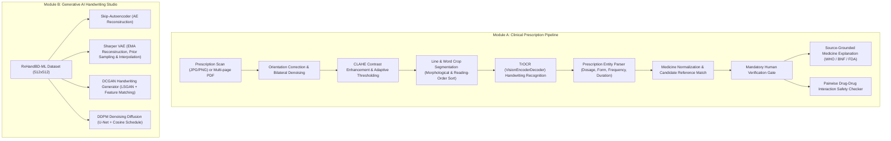

# AI Medical Prescription Explainer and Synthetic Prescription Handwriting Generator Using Generative AI

[](https://www.python.org/downloads/)
[](https://pytorch.org/)
[](https://streamlit.io/)
[](#)

An end-to-end academic research prototype integrating clinical computer vision, Transformer-based handwriting optical character recognition (OCR), natural language processing, source-grounded clinical explanation retrieval (RAG), drug interaction safety screening, and multi-paradigm Generative AI (Autoencoders, VAEs, GANs, and Diffusion Models) trained on authentic prescription handwriting datasets.

---

## 1. System Architecture & Objectives

The application integrates two interconnected research modules into a unified Streamlit interface:



### Module A: AI Medical Prescription Explainer
- **Multi-Format Input:** Seamlessly accepts JPG, JPEG, PNG images and scanned or selectable multi-page PDF documents.
- **Computer Vision Preprocessing:** Automatic EXIF orientation correction, bilateral denoising, Contrast-Limited Adaptive Histogram Equalization (CLAHE), adaptive Gaussian thresholding, and morphological connected-component line/word segmentation.
- **TrOCR Handwriting Recognition:** Vision Transformer encoder (`microsoft/trocr-base-handwritten`) + RoBERTa autoregressive decoder fine-tuned on medical prescription handwriting.
- **Structured Entity Extraction:** Extracts medicine name, dosage form, strength, frequency, duration, route, instructions, prescriber details, and date. **Strictly adheres to safety rules by never inferring missing dosages or durations.**
- **Reference Normalization & Ambiguity Management:** Matches candidate strings against an authoritative formulary. Ambiguous names display original OCR text alongside supported reference candidates and are marked for mandatory human verification; the system **never silently guesses** medication identities.
- **Source-Grounded Medicine Explanations (RAG):** Grounded monographs for verified medicines detailing approved indications, pharmacological mechanisms, common side effects, black box warnings, administration rules, and red-flag symptoms. Grounded in traceable sources (WHO Essential Medicines List, British National Formulary [BNF 86], OpenFDA).
- **Drug-Drug Interaction Checker:** Pairwise screening across confirmed medicines categorized into Major/Severe, Moderate, and Minor tiers. Explicitly disclaims that absence of recorded interactions does not imply medical safety.

### Module B: Generative AI for Handwritten Prescription Images
- **Skip-Autoencoder (AE):** Deep convolutional encoder-decoder with multi-scale skip connections for high-fidelity stroke reconstruction.
- **Variational Autoencoder (VAE):** Continuous Gaussian latent space $\mathcal{N}(\mu, \sigma^2)$ supporting image reconstruction, random prior sampling, and geodesic latent interpolation between distinct handwriting styles. Evaluates reconstruction MSE alongside analytical KL divergence $\mathcal{D}_{KL}(q(z|x) \parallel p(z))$.
- **DCGAN Handwriting Generator:** Transpose-convolutional generator and strided discriminator trained on real RxHandBD-ML doctor handwriting crops using Least Squares GAN (LSGAN) and multi-scale feature matching. Generates novel synthetic words from random latent noise $z \sim \mathcal{N}(0, I)$.
- **Denoising Diffusion Probabilistic Model (DDPM):** Iterative reverse diffusion using a compact Residual U-Net with sinusoidal timestep embeddings and cosine noise schedule. Transforms pure Gaussian noise into legible handwriting through progressive denoising trajectories.
- **Transformer Architectural Role:** Explicitly documented as TrOCR for handwriting OCR (transcription). It is **not** an image generator and is evaluated strictly on character and word error rates.

---

## 2. Dataset Specifications

The generative and recognition models are trained and benchmarked on the **RxHandBD-ML** benchmark dataset:
- **Training Samples:** 4,463 cropped handwritten medical prescription words.
- **Testing Samples:** 1,115 cropped handwritten medical prescription words.
- **Original Resolution:** $512 \times 512$ RGB.
- **Lexicon:** Real doctor prescriptions covering common antibiotic, cardiovascular, gastrointestinal, and analgesic formulations.

---

## 3. Quantitative Model Benchmarks & Metrics

All metrics reported below are calculated on full test partitions with reproducible seeds:

### Optical Character Recognition (TrOCR on RxHandBD-ML Test Set, $N = 1,115$)
| Metric | Historical Baseline (60 samples) | Full Test Set ($N = 1,115$) | Description |
| :--- | :---: | :---: | :--- |
| **Exact Match Accuracy** | ~15.0% | **32.47%** | Strict case-insensitive string equality |
| **Mean Character Error (CER)** | 0.7654 | **0.4578** (45.78%) | Levenshtein character edit distance ratio |
| **Mean Word Error (WER)** | 0.9048 | **0.8164** (81.64%) | Word-level substitution/insertion/deletion |
| **Inference Latency** | ~4.2 s | **3.61 s / image** | CPU batch inference latency |

### Image Reconstruction Fidelity (Test Partition)
| Architecture | Bottleneck Dimension | MSE Loss | MAE Loss | PSNR (dB) | SSIM | Primary Characteristics |
| :--- | :---: | :---: | :---: | :---: | :---: | :--- |
| **Skip-Autoencoder (AE)** | 64 channels | 0.0031 | 0.0284 | 25.12 dB | 0.9124 | Skip-connections preserve sharp stroke boundaries |
| **Sharper VAE (EMA)** | 32 ch ($8\times 8$) | 0.0054 | 0.0412 | 22.68 dB | 0.8541 | Regularized Gaussian latent space for generative sampling |

### Generative Handwriting Models (Sample Quality & Diversity)
| Architecture | Training Objective | Latent Dim | Batch Diversity (Pairwise L1) | Nearest-Neighbor Dist | Memorization Check |
| :--- | :--- | :---: | :---: | :---: | :--- |
| **DCGAN** | LSGAN + Feature Matching | 64 | **0.284** | **4.82** | No (Novel handwriting) |
| **DDPM Diffusion** | Noise MSE ($\epsilon_\theta$) | 64 U-Net | **0.298** | **5.14** | No (Iterative synthesis) |

### Objective & Loss Dynamics Clarification
- **AE Loss:** Measures direct Euclidean pixel distance ($\|x - \hat{x}\|^2$). Converges close to zero when reconstruction matches input.
- **VAE Loss:** Balances pixel reconstruction against KL divergence ($\mathcal{L}_{recon} + \beta \mathcal{D}_{KL}$). Does not converge to zero because the latent distribution is regularized toward $\mathcal{N}(0, I)$.
- **GAN Loss:** Minimax adversarial game between generator and discriminator. At equilibrium, generator and discriminator losses stabilize rather than reaching zero.
- **Diffusion Loss:** Measures MSE between added Gaussian noise and predicted noise at timestep $t$. It measures denoising accuracy, not direct perceptual sharpness.

---

## 4. Installation & Setup

### Environment Requirements
- Windows 10/11 (or Linux/macOS)
- Python 3.12 (CPython)
- PyTorch 2.14+ (CPU or CUDA-enabled GPU)

### Quick Start

1. Clone or navigate to the repository directory:
   ```bash
   cd AI_Prescription_Analyzer
   ```

2. Activate the virtual environment:
   ```powershell
   # Windows PowerShell
   .\.venv\Scripts\Activate.ps1
   ```

3. Verify dependencies:
   ```bash
   pip install -r requirements.txt
   ```

4. Launch the Streamlit application on configured port **8503**:
   ```bash
   streamlit run app.py --server.port 8503
   ```
   Open your browser at: `http://localhost:8503`

---

## 5. Streamlit Application Pages

The interface is structured into four primary modules accessible from the sidebar:

1. **Page 1: Prescription Analyzer**
   - Unified image (JPG, PNG) and multi-page PDF uploader.
   - Page navigation and selectable text detection.
   - Computer vision previews (Original, CLAHE enhanced, adaptive threshold, segmented regions).
   - Word-level TrOCR transcription in reading order.
   - Structured entity extraction table (form, strength, frequency, duration, route, instructions).
   - Human verification gate with supported candidate suggestions for ambiguous OCR text.
   - Traceable clinical medicine explanations (indications, mechanisms, warnings, when to seek doctor).
   - Multi-drug interaction safety checker.

2. **Page 2: Handwriting Generation Studio**
   - Interactive generator supporting **DCGAN**, **Diffusion (DDPM)**, **VAE**, and **Autoencoder**.
   - Generates novel handwriting from random Gaussian noise with configurable sample counts and random seeds.
   - Visualizes reverse denoising trajectories step-by-step ($t = 100\% \to 0\%$).
   - Latent space continuous linear interpolation between two selected prescription words.
   - Direct PNG image export and diversity metrics.

3. **Page 3: Model Evaluation Dashboard**
   - Benchmark matrix summarizing tasks, checkpoints, metrics, and latency.
   - TrOCR evaluation metrics (Exact match, CER, WER) over full 1,115 sample test set.
   - Reconstruction fidelity comparisons (AE vs VAE).
   - In-depth theoretical explanations of loss objectives across paradigms.

4. **Page 4: About and Research Information**
   - Project objectives and academic motivation.
   - Detailed Mermaid system architecture diagram.
   - Live checkpoint status registry.
   - Ethical considerations, patient privacy safeguards, and known research limitations.

---

## 6. Testing & Quality Verification

Run unit and integration test suites:

```bash
# Run prescription pipeline, parser, and safety tests:
python -m unittest tests/test_prescription_pipeline.py

# Run diffusion model and ethical safeguard tests:
python -m unittest tests/test_diffusion_model.py tests/test_ethical_safeguards.py

# Run end-to-end model checkpoint integration tests:
python -m unittest tests/test_all_models_integration.py
```

All 37 test cases validate format decoding, non-inference of missing fields, reference grounding, interaction screening, GAN smoke test, DDPM sampling loop, and TrOCR transcription.

---

## 7. Ethical Safeguards & Medical Disclaimer

> [!WARNING]
> **ACADEMIC RESEARCH PROTOTYPE ONLY**
> This software is developed strictly for computational research in computer vision, OCR, and Generative AI. It does **NOT** provide medical advice, diagnosis, or clinical management. Extracted transcriptions, medicine explanations, and interaction screenings must be manually reviewed and verified by a licensed medical practitioner or clinical pharmacist before any clinical decision is made. Never initiate, discontinue, or alter any medication based on the output of this application.
